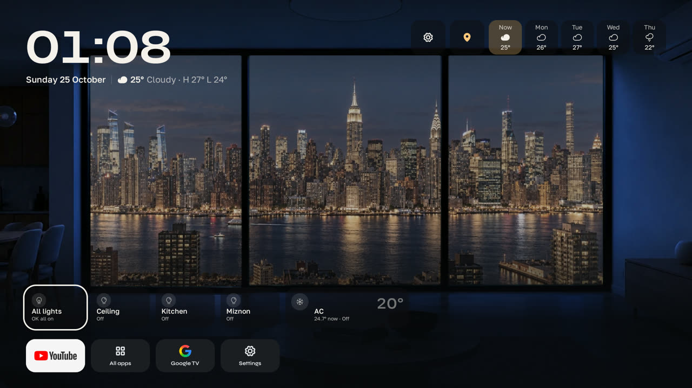
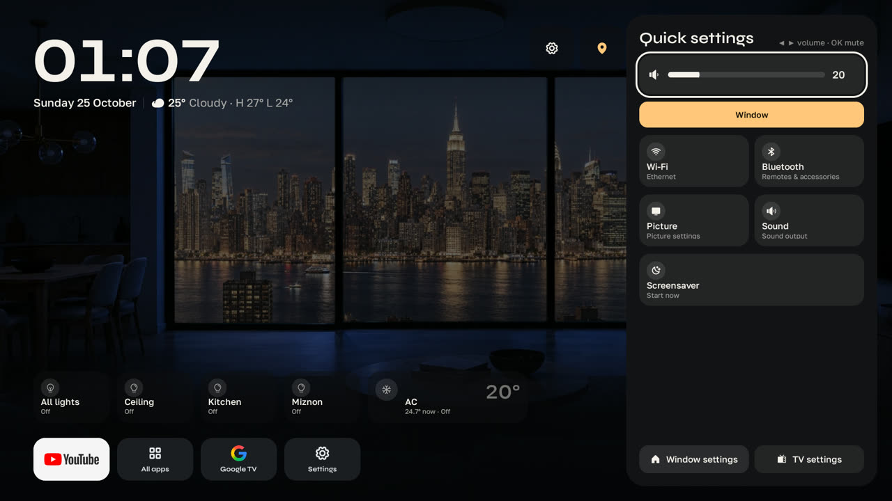
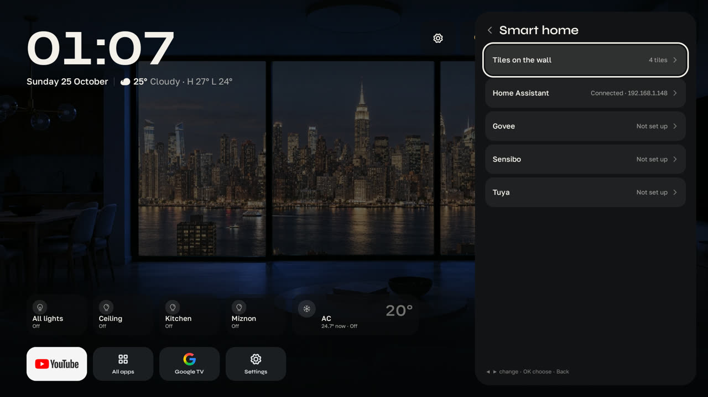
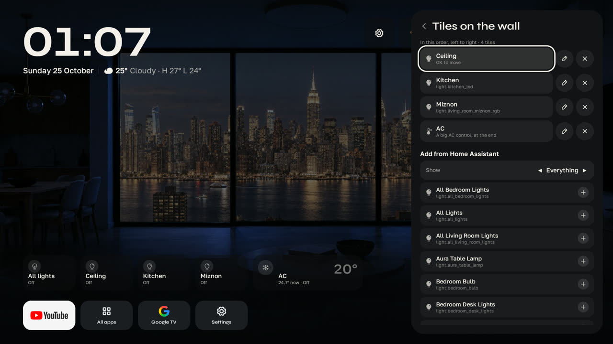
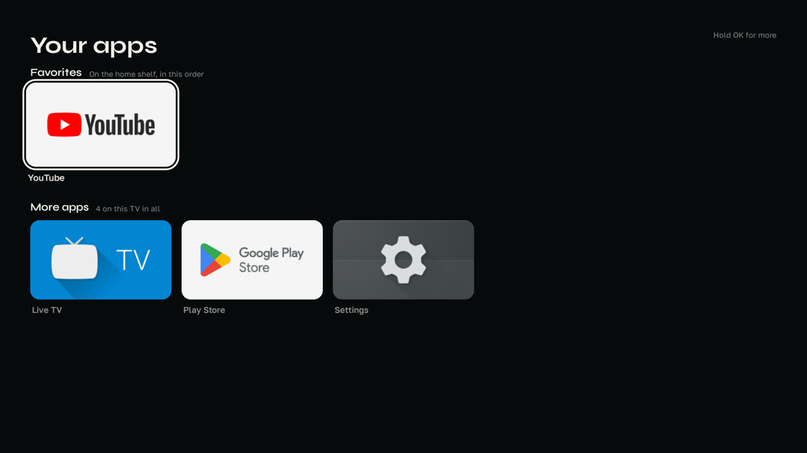
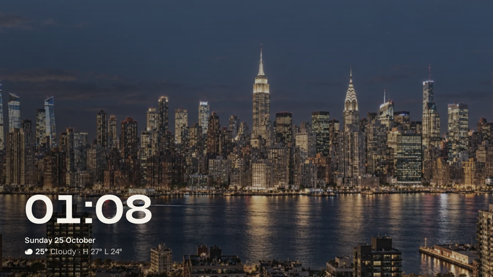

# Window

A home screen for Google TV. A room with a window onto a city, the time and the forecast, your apps on a
shelf, and your Home Assistant lights and AC on the wall. It replaces Google TV's own home and comes with
its own screensaver.

Built with Kotlin and Compose for TV. Package `com.dananz.window`, Android 12 (API 31) and up.



| | |
| --- | --- |
|  |  |
| Quick settings: volume, Wi-Fi, picture, sound, the screensaver | Smart home: Home Assistant, Govee, Sensibo, Tuya |
|  |  |
| Tiles on the wall: pick, reorder and rename | All apps, with favorites on the home shelf |



## What's in it

- **Home:** the room and the view, which follow the time of day, the weather and the place you pick (New
  York, Los Angeles, Dubai, an alpine village). Clock, date and a daily forecast you can step through.
- **Apps shelf** and an **All apps** screen with favorites, reordering and uninstall.
- **Quick settings** (the gear): volume, inputs, Wi-Fi, Bluetooth, picture and sound, and Window settings.
- **Window settings:** open an app on start, 12 or 24 hour clock, language (English or Hebrew, right to
  left), the screensaver, tiles on the wall, Home Assistant sign-in, reduced motion.
- **Home Assistant:** sign in from your phone with a QR code (no token to type), then pick which lights,
  AC, switches, fans, covers and scenes sit on the wall. The forecast also comes from Home Assistant
  (`weather.forecast_home`, the default Met.no entity).
- **Without Home Assistant:** Govee lights (on the network or with an API key), Sensibo ACs (API key from
  home.sensibo.com) and Tuya devices from Smart Life or Tuya Smart (the app's User Code, then scan a QR on the TV).
  Their devices join the same tile list.
- **Screensaver:** the camera goes through the window and stays on the landscape, with a clock that moves
  every few minutes and a slow drift, to spare OLED panels.
- **Home button:** Google TV ignores a third-party home screen, so an accessibility service catches the
  remote's Home button and brings Window up. `scripts/tv-default.sh` also switches Google TV's home off.

## Build

Needs JDK 21 and the Android SDK (platform 37, build tools 37).

```sh
brew install openjdk@21 android-platform-tools
export JAVA_HOME=$(brew --prefix openjdk@21)/libexec/openjdk.jdk/Contents/Home
cp local.properties.example local.properties   # then set sdk.dir
./gradlew assembleRelease
```

The APK is `app/build/outputs/apk/release/app-release.apk`.

Notes:

- The release build is signed with this machine's debug key, which is enough to sideload. An APK built on
  another machine won't install over it (different key): uninstall Window first.
- Always install the release build. The debug build runs interpreted and stutters on TV hardware.
- `local.properties` can also hold `ha.url` and `ha.token` (a long-lived Home Assistant token) to build an
  APK that's already signed in. Never share an APK built that way. Without them, sign in from Window settings.
- The fonts in `app/src/main/res/font` are Syne and Golos Text with Google Sans's Hebrew merged in.
  `scripts/fonts.sh` rebuilds them (needs `brew install fonttools`).

## Put it on a TV

On the TV: Settings > System > About, press Android TV OS build 7 times. Then Settings > System >
Developer options: turn on USB debugging and Network debugging (on some TVs, "ADB debugging").

```sh
adb connect <tv-ip>:5555          # accept the prompt on the TV, tick "Always allow"
echo "tv=<tv-ip>:5555" >> local.properties
scripts/tv-install.sh             # build, install, grant permissions, turn on the Home button service
scripts/tv-default.sh             # optional: make Window the real home and its screensaver the TV's
```

| Script | What it does |
| --- | --- |
| `tv-install.sh` | Release build, install, compile ahead of time, grant permissions, turn the Home button service on. Use it for every update. |
| `tv-default.sh` | Switches Google TV's home and setup wizard off (`pm disable-user`, nothing uninstalled), makes Window home and sets its screensaver. Checks first that this won't drop the TV off Wi-Fi. |
| `tv-check.sh [--fix]` | After a firmware update: is Window still home? Puts it back with `--fix`. |
| `tv-restore.sh` | Puts Google TV's home back. Run it before a factory reset. |

Every script takes `TV=<ip>:5555` on the command line, or reads `tv=` from `local.properties`.

On some TVs (a Sony BRAVIA on Android 12) Home reaches Window by itself once `tv-default.sh` has run, and
the Home button service only gets in the way: it stops held keys like volume from repeating. List such a TV
as `nohomebutton=<serial>` in `local.properties` (`adb shell getprop ro.serialno`) and the scripts leave the
service off. Window runs on Android 12 (API 31) and up.

## Setting it up with Claude

[`SETUP.md`](SETUP.md) is a prompt to paste into Claude Code. It walks a new TV through the steps above,
with the checks.
